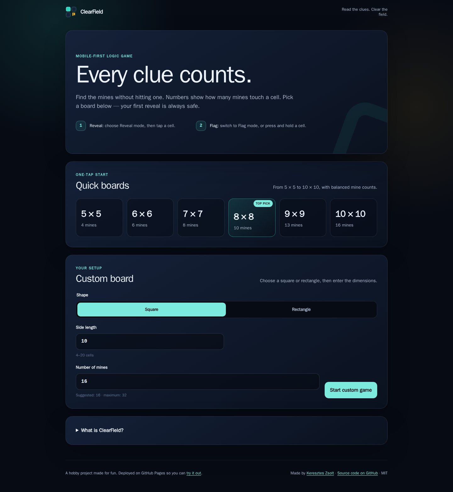
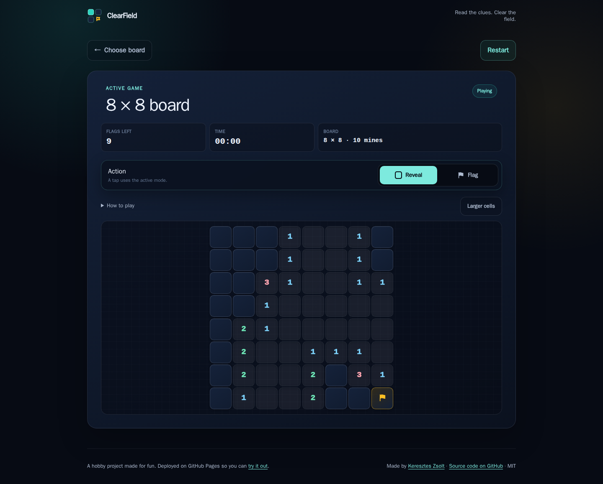
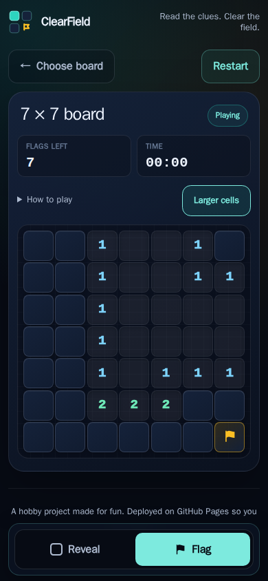

# ClearField

**Read the clues. Clear the field.**

ClearField is a mobile-first, independent, fan-made Minesweeper game built with HTML, vanilla JavaScript, and CSS. Choose a quick or custom board and play with touch, mouse, or keyboard. It needs no frontend framework, build step, external dependencies, account, or backend; gameplay results are not stored.

[**Play ClearField**](https://kereszteszsolt.net/clear-field/)

This is a hobby project made for fun, deployed on GitHub Pages so anyone can try it out.

## Screenshots

### Choose a board



### Play on desktop and mobile

<p align="center">
  
  
</p>

## Features

- One-tap starts for 5 × 5, 6 × 6, 7 × 7, 8 × 8, 9 × 9, and 10 × 10 boards.
- Custom square or rectangular boards from 4–20 columns and 4–30 rows.
- A clear **Reveal / Flag** mode selector that stays within reach at the bottom of mobile screens.
- Optional **Larger cells** for easier tapping, with a scrolling hint when a board does not fit.
- Quick flagging with a long press on touchscreens or a right-click on desktop.
- A safe first reveal; whenever the board density allows it, the surrounding cells are safe too.
- A responsive board with horizontal scrolling for larger custom layouts.
- Keyboard navigation and screen-reader-friendly cell labels.
- A timer for the current game, with no persistent result or gameplay storage.
- A cohesive visual style built with reusable CSS design tokens.

## Tech stack

| Area | Technology / approach |
| --- | --- |
| Gameplay | Vanilla JavaScript; no frontend framework |
| Interface | HTML5, CSS3, responsive layouts, reusable CSS design tokens |
| Interaction | DOM events, touch/mouse input, keyboard navigation, accessible labels |
| Deployment | Static site; no package installation or build process |

## Controls

| Device | Reveal | Flag |
| --- | --- | --- |
| Mobile / touch | Select Reveal mode, then tap | Select Flag mode and tap, or press and hold |
| Mouse | Left-click in Reveal mode | Right-click, or left-click in Flag mode |
| Keyboard | Navigate with arrow keys, press `R`, then Enter/Space | Press `F`, then Enter/Space |
| Restart | Press `N` | — |

## Run locally

ClearField is a static project, so no installation or build command is required. Opening `index.html` directly supports gameplay, the complete default About dialog and the MIT attribution. Serve the project folder locally to apply editable About metadata from `brand/branding.json`.

### Python

Run the following command from the folder that contains `index.html`:

```bash
python3 -m http.server 8080 --bind 127.0.0.1
```

On Windows, either of these commands may be available:

```powershell
py -m http.server 8080 --bind 127.0.0.1
```

```powershell
python -m http.server 8080 --bind 127.0.0.1
```

Then open `http://localhost:8080` in your browser. Stop the server with `Ctrl + C`.

## Project structure

```text
clear-field/
├── assets/favicon.svg
├── brand/                  # Editable JSON catalog and original artwork
├── css/
│   ├── styles.css
│   └── about.css
├── js/
│   ├── app-info.js
│   ├── about.js
│   ├── app.js
│   └── game.js
├── index.html
├── manifest.webmanifest
└── LICENSE
```

## GitHub About

**Repository name:** `clear-field`

**Description:**

> Mobile-first Minesweeper game built with vanilla JavaScript, HTML and CSS, featuring custom boards, touch controls and keyboard accessibility.

**Topics:**

`minesweeper`, `vanilla-javascript`, `html5`, `css3`, `browser-game`, `puzzle-game`, `mobile-first`, `responsive-design`, `accessibility`, `touch-controls`, `open-source`

## About and attribution

The header opens a native About dialog with a poster, description, project/author links, support actions and voluntary-support notice. Served pages load this content from the root catalog; a complete default dialog remains available when opening the HTML directly or if metadata cannot load. Tooltips expose descriptions, full URLs and the configured website languages. The dialog supports keyboard navigation, Escape, close-button and backdrop dismissal while preserving the current board. The footer shows the current year, configured author and MIT license on the left, with `authorWebsite` and the optional footer-only `extraWebsite` grouped on the right. Website links underline on hover, and the support notice preserves configured line breaks. Application code and styles use functional names; root metadata and legal license remain separate.

## About the project

ClearField is an independent, fan-made interpretation of classic Minesweeper gameplay, created as a standalone open-source project. It is not affiliated with, endorsed by, or partnered with any original game publisher.

## License

MIT. See [`LICENSE`](LICENSE) for details.

## Contact

**Project maintainer: Keresztes Zsolt**

| Platform | Link |
| --- | --- |
| Website | [kereszteszsolt.hu](https://kereszteszsolt.hu/) |
| GitHub | [@kereszteszsolt](https://github.com/kereszteszsolt) |

> The website is available in multiple languages: Hungarian (HU), English (EN), Romanian (RO), and German (DE).

## ☕ Ways to support

**Explore ways to support the maintainer and their projects.**

[https://kereszteszsolt.hu/en/ways-to-support/](https://kereszteszsolt.hu/en/ways-to-support/)

<p align="center">
  <a href="https://buymeacoffee.com/kereszteszsolt"></a><br>
  <strong>Every coffee counts! ☕❤️</strong>
</p>

---

<p align="center">
  <strong>Made with ❤️ by <a href="https://kereszteszsolt.hu/">Keresztes Zsolt</a></strong><br>
  ⭐ Star this repository if you found it helpful!
</p>

### About verification — 2026-10-19

Local Chromium checks at widths from 320px to 1440px covered the complete About dialog over HTTP and as a local file, link tooltips, keyboard/close/backdrop dismissal, focus restoration, viewport bounds and preservation of the current board. Focused checks also covered custom square/rectangle starts, desktop button and instruction alignment, footer domain alignment and hover styling, optional website metadata, failed metadata loading and separate support-sentence lines. The existing keyboard shortcut handler ignores input while a dialog is open. No framework, build step or automated game test suite was introduced. The original MIT license and artwork remain unchanged; hosted deployment was not performed.
